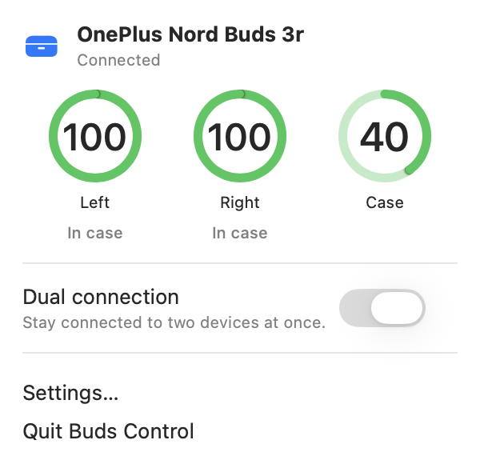
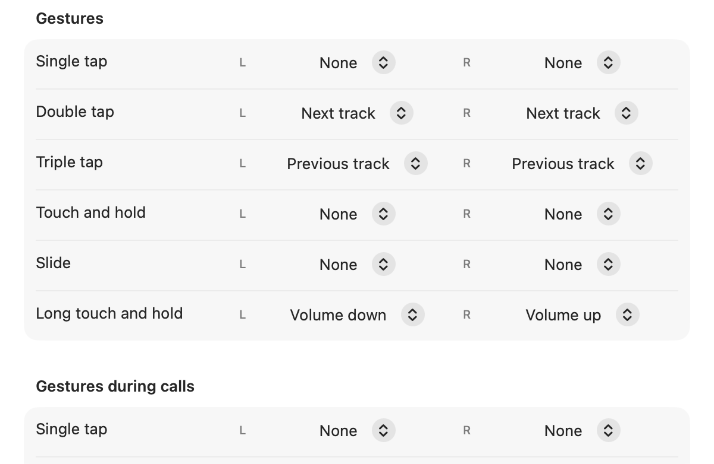

# Buds Control for Mac

A native macOS menu-bar app for OPPO, OnePlus and realme earbuds. See battery levels, turn dual
connection (multipoint) on and off, and remap touch gestures, all without a phone.

<p>
  
  
</p>

## Install

1. Download **BudsControl.dmg** from the [latest release](https://github.com/junedkhatri31/buds-control/releases/latest).
2. Open it and drag **Buds Control.app** onto **Applications**.
3. Launch **Buds Control** from Applications. It appears in the menu bar as an earbuds icon.

The app is locally signed but not notarized, so macOS may block the first launch. Open
**System Settings → Privacy & Security → Security → Open Anyway** and confirm **Open**. See the
[installation guide](docs/INSTALL.md#allow-the-first-launch-in-macos) for details.

Requires macOS 14 or later, on Apple Silicon or Intel.

## Connect your earbuds

Pair and connect the earbuds in **System Settings → Bluetooth**. Buds Control finds compatible
earbuds automatically and links up whenever they connect. Allow Bluetooth access when macOS asks.

## Features

- **Battery:** left, right and case levels, with charging and in-ear/in-case status. Updates live,
  and the lowest earbud level shows next to the menu-bar icon.
- **Dual connection:** turn multipoint on or off, and see which devices the earbuds are connected to.
- **Gestures:** change what single, double and triple taps, holds, slides or squeezes do on each
  earbud, including the separate in-call gestures. Choose **Show all functions** for the full list.
- **Firmware versions** for each earbud and the case.
- Settings window (**⌘,**) with everything above, plus a manual refresh.

## Compatibility

Buds Control works with earbuds that expose the OPPO/OnePlus/realme Bluetooth control service. It
doesn't keep a model list. It asks the earbuds which features they support and shows only those.
The gesture list comes from the slots the earbuds report, so different layouts (taps, squeezes,
slides, middle buttons) all work.

Tested on **OnePlus Nord Buds 3r**. Other models should work, and reports are welcome in
[issues](https://github.com/junedkhatri31/buds-control/issues). The earbuds don't say which functions
each gesture accepts, so the app offers sensible defaults. If the earbuds reject a choice, the app
shows an error and restores the current setting.

## Build from source

Requires Xcode 15 or later.

```bash
swift test                 # protocol tests using bytes captured from real earbuds
./scripts/build-app.sh     # universal app, DMG, ZIP and SHA256SUMS in ./dist
open "dist/Buds Control.app"
```

The protocol is documented in [docs/PROTOCOL.md](docs/PROTOCOL.md).

### Debug flags

Pass these after `--args` when opening the app:

* `--selftest`: connects, prints everything it reads, runs reversible writes, then exits.
* `--show-window`: opens the settings window at launch.
* `--preview-menu`: shows the menu-bar popover's content in a normal window.
* `--snapshot <dir>`: writes PNGs of the app's windows after 8 s, then exits.

```bash
open -W --stdout /dev/stdout "dist/Buds Control.app" --args --selftest
```

## Layout

| Path | What |
|---|---|
| `Sources/BudsKit` | Protocol: framing, parsers, capability table, RFCOMM transport, device model |
| `Sources/BudsControl` | SwiftUI menu-bar app and settings window |
| `Tests/BudsKitTests` | Unit tests using bytes captured from real earbuds |
| `tools/probe.swift` | Command-line RFCOMM probe for sending single commands |
| `scripts/` | App packaging and icon generation |
| `docs/` | Protocol notes and installation guide |

## License

MIT. See [LICENSE](LICENSE).

Not affiliated with or endorsed by OPPO, OnePlus or realme. Product names are trademarks of their
respective owners and are used only to describe compatibility.
